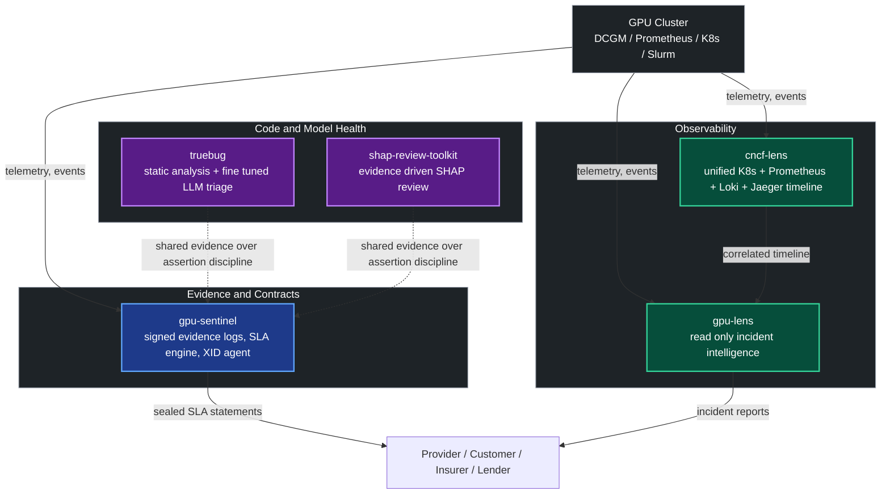
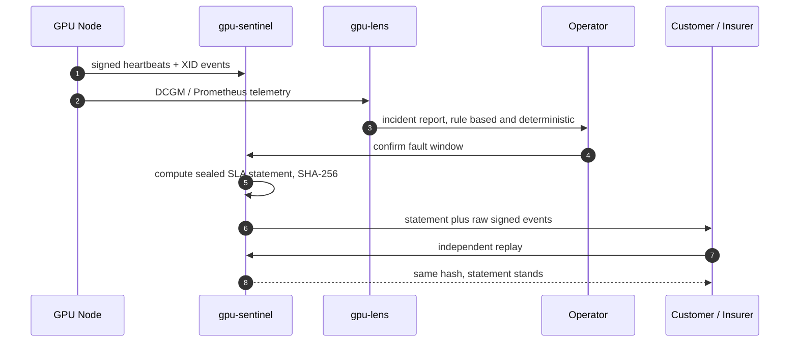
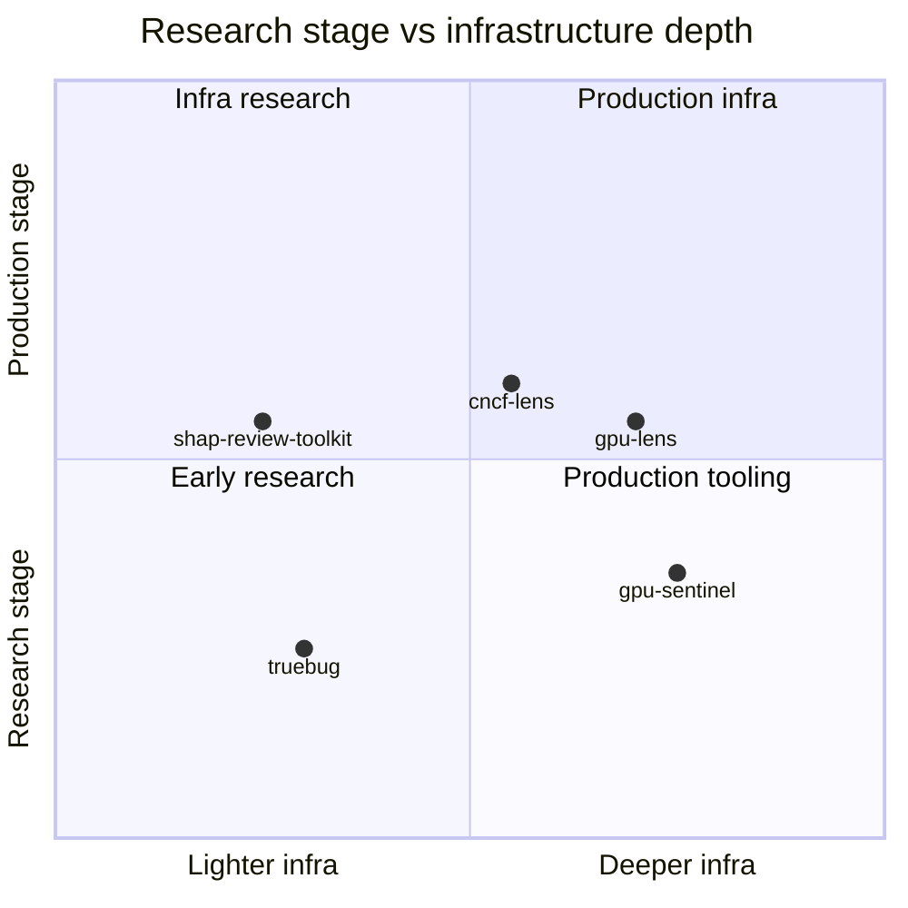
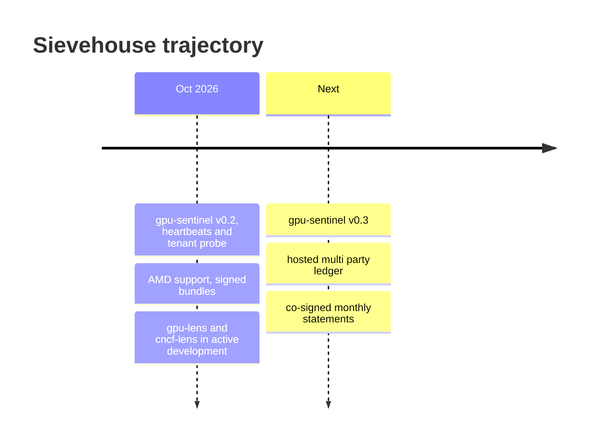

  

  # Sievehouse

  

  
  
  
  
  

 

## About

Sievehouse explores software opportunities across GPU and AI infrastructure, with a focus on reliability, independent verification, and evidence based performance assurance.

Current research investigates how GPU cloud customers and providers can verify delivered compute quality against contractual requirements: acceptance testing, SLA evidence, tenant isolation assurance, and compute risk signals relevant to lenders and insurers.

We prioritize independent research, reproducible measurements, open source tooling, and evidence driven validation. We test assumptions before committing to building a product. This is a research backed opportunity, not a claim of an established commercial offering.

## Tech stack

  

## Ecosystem

A layered view of how the projects relate: evidence at the base, observability in the middle, research and code health feeding the same discipline back in.

### How a dispute gets resolved

### Project positioning

Illustrative, not a scorecard.

## Projects

<table>
<tr>
<td width="50%">

Signed, hash chained evidence logs and a replayable SLA engine for rented GPU clusters. Sealed monthly statements, provider vs tenant corroboration, group testing fault localization.

</td>
<td width="50%">

Self-hosted, strictly read only GPU fleet diagnostics for Kubernetes. Six deterministic rules turn DCGM and K8s state into incident reports. [Live demo](https://gpu-lens.onrender.com/)

</td>
</tr>
<tr>
<td width="50%">

Unified CLI correlating Kubernetes, Prometheus, Loki, and Jaeger onto one timeline.

</td>
<td width="50%">

Self-hosted repository intelligence: static analysis candidates verified and triaged by small fine tuned LLMs. No commercial LLM API dependency.

</td>
</tr>
<tr>
<td width="50%">

Evidence driven, reproduction first toolkit for reviewing the [SHAP](https://github.com/shap/shap) library: static, runtime, and differential analysis, fuzzing, provenance tracking.

</td>
<td width="50%" valign="top">

**Also in the org**

`crosscurrent` and `plumb`: placeholders, no code pushed yet.

`.github`: the org profile repo this file lives in.

</td>
</tr>
</table>

## Design principles

| Principle | What it means in practice |
|---|---|
| No AI in verdicts that move money or claim a defect | Deterministic engines decide; models triage, explain, draft |
| Evidence over assertion | Every claim traces to a signed log, a replay, or a reproduction |
| Least privilege, read only by default | gpu-lens and gpu-sentinel agents only read; never reset, drain, or schedule |
| Two vantage points beat one | Provider and tenant probes measure independently, then get compared |
| Honest limits | "No defect found by these tests" is the ceiling, never "no defect exists" |

## Roadmap

## Connect

*Open-source engineering. Independent verification. Evidence over assumptions.*

