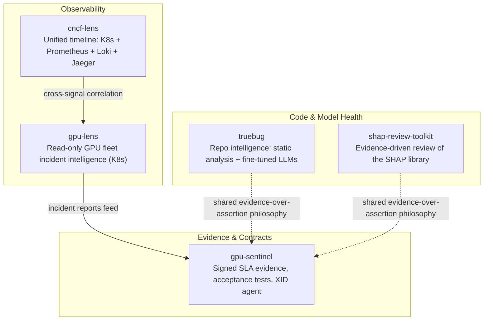

# Sievehouse

**Open-source engineering for GPU and AI infrastructure — reliability, independent verification, evidence over assumptions.**

---

## About

Sievehouse explores software opportunities across GPU and AI infrastructure, with a focus on reliability, independent verification, and evidence-based performance assurance.

Current research investigates how GPU cloud customers and providers can verify delivered compute quality against contractual requirements: acceptance testing, SLA evidence, tenant-isolation assurance, and compute-risk signals relevant to lenders and insurers.

We prioritize independent research, reproducible measurements, open-source tooling, and evidence-driven validation. We test assumptions before committing to building a product. This is a research-backed opportunity, not a claim of an established commercial offering.

## Ecosystem

Five tools, one idea: don't assert, verify. A finding, a reading, or a claim is only as good as the evidence chain behind it.

## Projects

| Project | Status | Stack | What it does |
|---|---|---|---|
| [gpu-sentinel](https://github.com/Sievehouse/gpu-sentinel) | Pre-alpha v0.2.0 | Go, Python | Signed, hash-chained evidence logs + a replayable SLA engine for rented GPU clusters. Produces sealed, independently-recomputable monthly SLA statements and provider-vs-tenant corroboration reports. |
| [gpu-lens](https://github.com/Sievehouse/gpu-lens) | Active | Go, React/TS | Self-hosted, strictly read-only GPU fleet diagnostics for Kubernetes. Correlates DCGM/Prometheus telemetry with K8s state via 6 deterministic rules into incident reports. [Live demo](https://gpu-lens.onrender.com/) |
| [cncf-lens](https://github.com/Sievehouse/cncf-lens) | Active | Go | Unified CLI correlating Kubernetes, Prometheus, Loki, and Jaeger onto one timeline. |
| [truebug](https://github.com/Sievehouse/truebug) | Research / early | Go, Python | Self-hosted repository intelligence: static-analysis candidates verified and triaged by small fine-tuned LLMs, for Go, Python, C++, and cloud-native repos. No commercial LLM API dependency. |
| [shap-review-toolkit](https://github.com/Sievehouse/shap-review-toolkit) | Active | Python | Evidence-driven, reproduction-first toolkit for reviewing the [SHAP](https://github.com/shap/shap) library: static, runtime, and differential analysis, fuzzing, provenance tracking. |
| crosscurrent | Placeholder | — | Empty, no code yet. |
| plumb | Placeholder | — | Empty, no code yet. |

## Design principles

The same rules run across every project:

- **No AI in verdicts that move money or claim a defect exists.** Deterministic engines decide; models triage, explain, and draft.
- **Evidence over assertion.** Every claim traces back to a signed log, a replay, or a reproduction, never a confidence score alone.
- **Least privilege, read-only by default.** The gpu-lens and gpu-sentinel agents only read; nothing resets GPUs, drains nodes, or touches schedulers.
- **Two vantage points beat one.** Where possible (gpu-sentinel's provider/tenant probes), independent measurement from both sides replaces a single trusted dashboard.
- **Honest limits.** "No defect found by these tests" is the ceiling of any claim, never "no defect exists."

## Status

Early-stage, single-maintainer org. Most repos are active development or pre-alpha.

## Connect

- GitHub: [github.com/Sievehouse](https://github.com/Sievehouse)
- LinkedIn: [linkedin.com/company/144023602](https://www.linkedin.com/company/144023602/)
- Email: sievehouse.gpu@gmail.com

---

*Open-source engineering. Independent verification. Evidence over assumptions.*

